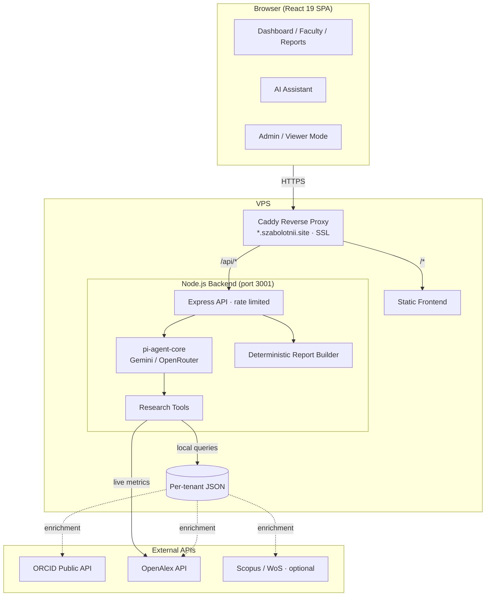
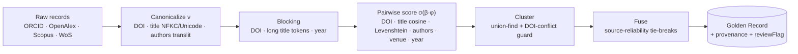
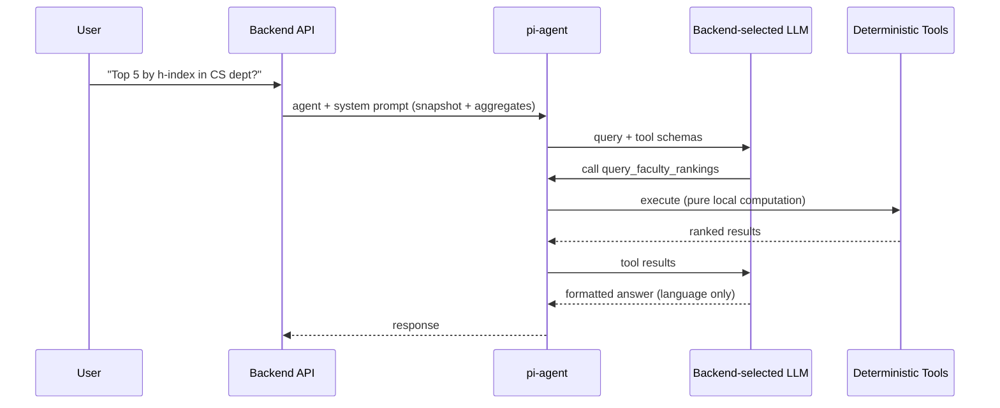
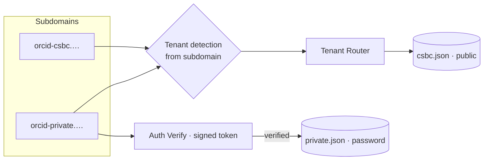

<div align="center">


# ResearchIQ: AI-Powered Academic Analytics

[](https://openrouter.ai/)
[](https://github.com/badlogic/pi-mono)
[](https://react.dev/)
[](https://www.typescriptlang.org/)
[](tests/)
[](LICENSE)

**Multi-tenant research analytics platform** for university administrators.<br/>
Aggregate faculty data from ORCID + OpenAlex (and optionally Scopus / Web of Science), reconcile it into one authoritative record per publication, analyze it with an AI agent, and generate ministry-ready reports.

[**Live Demo**](https://orcid-csbc.szabolotnii.site) · [Kaggle Writeup](https://www.kaggle.com/competitions/gemini-3/writeups/orcid-and-openalex-research-aggregator) · [Report Bug](https://github.com/SZabolotnii/ORCID-OpenAlex-Research-Aggregator/issues)

</div>

---

## Table of Contents

- [Why ResearchIQ](#why-researchiq)
- [What This Repository Contains](#what-this-repository-contains)
- [Design Philosophy](#design-philosophy)
- [Architecture](#architecture)
  - [System overview](#system-overview)
  - [Golden Record — data reconciliation engine](#golden-record--data-reconciliation-engine)
  - [AI agent](#ai-agent)
  - [Deterministic report generation](#deterministic-report-generation)
  - [Multi-tenant data flow](#multi-tenant-data-flow)
- [Tech Stack](#tech-stack)
- [Quick Start](#quick-start)
- [Configuration](#configuration)
- [Importing Faculty Data](#importing-faculty-data)
- [Testing](#testing)
- [Benchmark](#benchmark)
- [Project Structure](#project-structure)
- [Multi-tenant Setup](#multi-tenant-setup)
- [Deployment](#deployment)
- [Research & Citation](#research--citation)
- [Contributing](#contributing)
- [License & Contact](#license--contact)

---

## Why ResearchIQ

University administrators spend **tens of hours per reporting cycle** compiling research output for accreditation and ministry (MON) requirements. The data is fragmented across **ORCID, OpenAlex, Scopus, Web of Science** and local spreadsheets, and the same publication appears in several systems with slightly different metadata. Manual copy-paste, deduplication and formatting are slow and error-prone — a reproducible synthetic-model estimate puts the manual effort at **~70 hours per 50-faculty cycle** (see [Benchmark](#benchmark)).

ResearchIQ automates the workflow end to end:

1. **Import** faculty by ORCID iD (CSV or UI).
2. **Aggregate** publications and metrics from ORCID + OpenAlex (Scopus/WoS optional).
3. **Reconcile** multi-source records into a single **Golden Record** per publication, with provenance.
4. **Analyze** with an AI agent that has the full institutional snapshot in context.
5. **Generate** standardized reports (Scopus/WoS list, attestation card, accreditation) and fill custom templates.

> **Origin.** Built for the [Vibe Coding with Gemini 3 Pro](https://www.kaggle.com/competitions/gemini-3) Kaggle competition (a 5-hour Google AI Studio prototype), then evolved into a full multi-tenant platform with a pi-agent backend and a deterministic reconciliation engine. [Read the writeup](https://www.kaggle.com/competitions/gemini-3/writeups/orcid-and-openalex-research-aggregator).

---

## What This Repository Contains

This is the public source repository for **ResearchIQ**, not just an experiments dump. It contains:

- the production-oriented **React frontend** and **Node/Express backend**;
- the deterministic **Golden Record** Entity-Resolution engine used by the application;
- the backend **agent tool layer** for research analytics over tenant data;
- deterministic report-generation code and multi-tenant data handling;
- a reproducible synthetic benchmark with tracked outputs in [`paper/benchmark/`](paper/benchmark/);
- unit tests for the deterministic core in [`tests/`](tests/);
- manuscript sources and submission artifacts in [`paper/`](paper/).

In the accompanying ITLT manuscript, the repository supports the following claim: ResearchIQ is a software implementation of the proposed **TRACE-aligned methodology** for trustworthy AI-assisted research administration, while the benchmark and tests make the deterministic core independently reproducible.

All code and documentation in this repository are released under the [MIT License](LICENSE).

---

## Design Philosophy

ResearchIQ deliberately keeps the LLM **out** of the number-crunching path. Trust in an analytics system is a property of the **architecture**, not of the model:

- **Deterministic core for structured data.** Deduplication, metric aggregation, and report tables are computed by plain, testable TypeScript — reproducible and free of arithmetic/citation hallucination.
- **LLM only where language is genuinely needed.** Natural-language questions, explanations, and report *narrative* — never the figures.
- **Provenance & review.** Every reconciled record carries how it was assembled and is flagged when a near-duplicate could not be resolved automatically (human-in-the-loop).

This mirrors the **TRACE** engineering framework for trustworthy agentic AI (deterministic L1 core, classical-ML L2a, LLM-validator L2b, explicit escalation and human supervision). The accompanying manuscript and reproducible benchmark live in [`paper/`](paper/). See [Research & Citation](#research--citation).

---

## Architecture

### System overview



### Golden Record — data reconciliation engine

The heart of the platform is a **dependency-free, deterministic Entity-Resolution pipeline** ([`services/goldenRecord.ts`](services/goldenRecord.ts)) that turns the same publication's many source records into one authoritative **Golden Record**:



Key properties:

- **Cyrillic-safe normalization.** Titles are normalized with the Unicode `\p{P}` class (the earlier `[^\w\s]` rule silently gutted Ukrainian/Cyrillic titles); author names are transliteration- and order-invariant (`Заболотній С.` ↔ `S. Zabolotnii`).
- **Logistic pairwise scoring** `σ(β·φ)` over interpretable features (DOI match `+3.0`, **DOI conflict `−5.0`**, title cosine, char similarity, author/venue Jaccard, year agreement) with two thresholds: `θ_match = 0.90` (auto-merge) and `θ_review = 0.70` (flag for review).
- **Fail-fast guard.** Two records with *different valid DOIs* are **never** auto-merged.
- **Provenance + HITL.** Each Golden Record records its contributing sources, the winning source per field, the weakest accepted-merge score, cluster size, and a `reviewFlag` when an unresolved near-duplicate exists — surfaced via `reviewFlaggedPublications()` for an admin to confirm or split.

The engine ships with a reproducible [synthetic benchmark](#benchmark) and a [unit-test suite](#testing).

### AI agent

The assistant is powered by [pi-agent-core](https://github.com/badlogic/pi-mono) (MIT, by Mario Zechner). The backend builds a system prompt containing a **full faculty snapshot + pre-computed aggregates**, so most questions are answered directly from context. For filtering, ranking, full publication lists, or live lookups, the agent calls one of **nine deterministic research tools** ([`server/src/tools.ts`](server/src/tools.ts)): `query_faculty_rankings`, `search_local_publications`, `get_department_comparison`, `get_faculty_detail`, `get_citation_trends`, `find_collaboration_network`, `get_author_metrics_live`, `search_global_works`, `get_current_date`. The backing LLM is selected server-side via `LLM_PROVIDER`.



> See [docs/pi-agent.md](docs/pi-agent.md) for agent configuration, tool design, and system-prompt notes.

### Deterministic report generation

Reports ([`server/src/reportStats.ts`](server/src/reportStats.ts) + [`reportService.ts`](server/src/reportService.ts)) are assembled in two parts:

- **Numeric / bibliographic backbone — built in code, no LLM.** Department summaries, per-faculty metrics, indexed-publication lists and data-quality notes are computed deterministically over **every** faculty member (no truncation), so counts, citations and DOIs are always correct and reproducible.
- **Narrative — LLM, grounded.** The model writes only the executive summary and recommendations around the authoritative figures, and degrades to a deterministic fallback if the provider is unavailable.

Report types: `scopus_wos`, `faculty_card`, `accreditation`, `general`, plus custom DOCX/XLSX/CSV/PDF/Markdown template filling.

### Multi-tenant data flow



Each institution gets `orcid-{id}.szabolotnii.site` with isolated data, public/private access control, and a server-verified admin/viewer role issued as a signed token (`AUTH_TOKEN_SECRET`).

---

## Tech Stack

| Layer | Technologies |
|-------|-------------|
| **Frontend** | React 19, TypeScript, Vite, TailwindCSS, Recharts, React Router 7 |
| **Backend** | Node.js, Express, pi-agent-core, provider resolver (Gemini / OpenRouter) |
| **Core** | Dependency-free Golden Record ER engine; deterministic report builder |
| **Data sources** | ORCID Public API, OpenAlex; Scopus (server-side proxy) and WoS optional |
| **Tooling** | `node:test` (via `tsx`), synthetic Monte-Carlo benchmark, ESLint, `tsc` |
| **Deployment** | VPS, PM2, Caddy (reverse proxy + SSL) |

---

## Quick Start

### Prerequisites

- **Node.js 20+** ([download](https://nodejs.org/))
- A **Gemini** or **OpenRouter** API key

### Local development

```bash
# 1. Clone
git clone https://github.com/SZabolotnii/ORCID-OpenAlex-Research-Aggregator.git
cd ORCID-OpenAlex-Research-Aggregator

# 2. Install (frontend, then backend)
npm install
cd server && npm install && cd ..

# 3. Configure the backend (Gemini example)
cat > server/.env <<'EOF'
LLM_PROVIDER=gemini
GEMINI_API_KEY=your_key_here
PORT=3001
DATA_DIR=./data
AUTH_TOKEN_SECRET=replace-with-a-long-random-secret
EOF
# (or: cp server/.env.production.example server/.env)

# 4. Run both dev servers
cd server && npm run dev &   # backend on :3001
npm run dev                  # frontend on :3000 (proxies /api → :3001)
```

Open [http://localhost:3000](http://localhost:3000).

### Verify your checkout

```bash
npm test          # unit tests (deterministic core)
npm run lint
npm run typecheck
npm run build
```

---

## Configuration

All backend settings live in `server/.env` (template: [`server/.env.production.example`](server/.env.production.example)).

| Variable | Purpose |
|----------|---------|
| `LLM_PROVIDER` | `gemini`, `openrouter`, or `auto` |
| `GEMINI_API_KEY` | required for `gemini` (and fallback in `auto`) |
| `OPENROUTER_API_KEY` | required/preferred for `openrouter` / `auto` |
| `OPENROUTER_MODEL` · `OPENROUTER_CHAT_MODEL` · `OPENROUTER_REPORT_MODEL` | pin models (global / chat / report) |
| `AUTH_TOKEN_SECRET` | **required** — signs tenant auth tokens |
| `SCOPUS_API_KEY` · `SCOPUS_REFERER` | optional Scopus enrichment (domain-locked Elsevier key) |
| `PORT` · `DATA_DIR` | server port (3001) and data directory |

**Provider modes:** `auto` prefers OpenRouter when `OPENROUTER_API_KEY` is set, else Gemini. For OpenRouter, the backend can auto-discover a current free model, cache it, and fall back to `openrouter/free`; pin explicitly with the `OPENROUTER_*_MODEL` variables. See [docs/openrouter-deployment.md](docs/openrouter-deployment.md).

---

## Importing Faculty Data

```bash
npx tsx scripts/import-csv.ts faculty.csv \
  --tenant csbc \
  --institution "University Name" \
  --output backup.json

# Options:
#   --site <url>          Target site (default: https://orcid-tracker.szabolotnii.site)
#   --tenant <id>         Tenant ID (default: "default")
#   --institution <name>  Default institution name
#   --department <name>   Default department
#   --position <name>     Default position (default: Associate Professor)
#   --admin-password / --auth-token   Credentials for the protected endpoint
#   --output <file>       Also save JSON locally
#   --dry-run             Fetch data without uploading
```

The importer fetches ORCID + OpenAlex data and reconciles it through the Golden Record engine before uploading.

---

## Testing

Unit tests use **Node's built-in test runner** (`node:test`) via `tsx` — zero extra test framework:

```bash
npm test
```

Specs in [`tests/`](tests/) cover the deterministic core:

- **`goldenRecord.test.ts`** — DOI canonicalization, Cyrillic-safe title normalization, transliteration-invariant author keys, pairwise scoring, clustering, the **DOI-conflict fail-fast guard**, review-band flagging, and the DOI-only / Title+Year baselines.
- **`dataMergeService.test.ts`** — cross-source merge, source tagging, and `reviewFlaggedPublications`.
- **`reportStats.test.ts`** — aggregates, Markdown tables, data-quality notes, faculty cards, and the **50-faculty no-truncation regression**.

---

## Benchmark

A reproducible, dependency-free Monte-Carlo benchmark ([`scripts/synthetic-benchmark.ts`](scripts/synthetic-benchmark.ts)) generates a **synthetic** model university (no real institution or personal data), projects each work into ORCID/OpenAlex/Scopus records with controlled, gold-labelled duplication and corruption, then runs the **real** engine plus DOI-only and Title+Year baselines on identical inputs.

```bash
npm run benchmark                                   # default: 150 researchers, 20 departments
npx tsx scripts/synthetic-benchmark.ts \
  --researchers 50 --departments 4 \
  --outdir paper/benchmark/faculty50               # the 50-faculty case used in the paper
```

It reports pairwise Precision/Recall/F1 and B³ F1, merged-field accuracy, engine compute time vs a transparent analytic manual-effort model, and sensitivity sweeps (mean ± 95% CI). Artifacts and the LaTeX manuscript are in [`paper/`](paper/).

Current tracked `faculty50` artifact (`paper/benchmark/faculty50/metrics_summary.json`, generated from code `9dcaa82`) reports:

| Method | Precision | Recall | F1 | B³ F1 |
|--------|-----------|--------|----|-------|
| DOI-only | 100.00 ± 0.00 | 42.44 ± 1.40 | 59.50 ± 1.37 | 93.69 ± 0.16 |
| Title+Year | 82.52 ± 1.40 | 38.87 ± 1.27 | 52.78 ± 1.32 | 92.61 ± 0.16 |
| Golden Record | 87.82 ± 1.03 | 67.19 ± 1.26 | 76.08 ± 0.96 | 95.67 ± 0.15 |

The same artifact estimates **71.5 hours** of manual effort for a 50-faculty, 4-department cycle using a transparent analytic model, while the measured engine time covers only local deduplication and fusion compute. These figures exclude network retrieval from ORCID/OpenAlex/Scopus.

> The benchmark is synthetic and does not use private personal data. Any tracked demo faculty files are for application demonstration and should remain limited to public ORCID/OpenAlex-derived records.

---

## Project Structure

```
ORCID-OpenAlex-Research-Aggregator/
├── App.tsx                     # Routing, state, admin/viewer modes, tenant detection
├── components/                 # Dashboard, FacultyList, ChatInterface, ReportGenerator, …
├── services/
│   ├── goldenRecord.ts         # ★ Deterministic Entity-Resolution engine (Golden Record)
│   ├── dataMergeService.ts     # Production merge wrapper + HITL review surfacing
│   ├── facultyDataService.ts   # ORCID/OpenAlex/Scopus/WoS enrichment pipeline
│   ├── orcidService.ts · openAlexService.ts · scopusService.ts · wosService.ts
│   ├── geminiService.ts        # Frontend client for /api/chat and /api/reports/generate
│   └── tenantApi.ts            # Tenant auth + protected data access
├── server/src/
│   ├── index.ts                # Express API: tenants, data, auth, chat, reports, rate limits
│   ├── agent.ts                # pi-agent config, system prompt, context builders
│   ├── tools.ts                # 9 deterministic research tools
│   ├── reportStats.ts          # ★ Deterministic report tables/statistics (no LLM)
│   ├── reportService.ts        # Report assembly: deterministic core + grounded narrative
│   ├── llmProvider.ts          # Gemini/OpenRouter resolver + free-model discovery
│   └── scopusService.ts        # Domain-locked Elsevier proxy
├── tests/                      # node:test specs (npm test)
├── scripts/
│   ├── synthetic-benchmark.ts  # Reproducible ER benchmark
│   └── import-csv.ts           # CLI data import
├── paper/                      # LaTeX manuscript + benchmark artifacts
├── contexts/ · utils/          # Bilingual (EN/UA) context and translations
├── docs/                       # pi-agent, OpenRouter deployment, smoke checklist
└── types.ts                    # Frontend shared types
```

★ = the deterministic, fully-tested core.

---

## Multi-tenant Setup

Each institution gets a subdomain `orcid-{id}.szabolotnii.site`:

```bash
# 1. Add a DNS A-record: orcid-{id}.szabolotnii.site → VPS IP
# 2. Add the subdomain to the Caddy config
# 3. Import data:
npx tsx scripts/import-csv.ts faculty.csv --tenant {id} --institution "Name"
```

Tenant registry (`data/tenants.json`):

```json
[{ "id": "csbc", "subdomain": "orcid-csbc", "name": "…", "public": true, "adminPasswordHash": "" }]
```

- `public: true` — dashboard visible to all; admin actions require a password.
- `public: false` — the whole dashboard requires a password (viewer token).

---

## Deployment

```bash
# Backend
scp -r server/src/* root@server:/opt/orcid-tracker-api/src/
ssh root@server "cd /opt/orcid-tracker-api && npx tsc && pm2 restart orcid-api"

# Frontend
npm run build
scp -r dist/* root@server:/var/www/orcid-tracker/
```

```caddyfile
orcid-tracker.szabolotnii.site, orcid-csbc.szabolotnii.site {
  handle /api/* { reverse_proxy 172.18.0.1:3001 }
  handle        { reverse_proxy orcid-tracker:80 }
}
```

See [server/.env.production.example](server/.env.production.example), [docs/openrouter-deployment.md](docs/openrouter-deployment.md), and [docs/production-smoke-checklist.md](docs/production-smoke-checklist.md).

**Smoke check** against a running API:

```bash
APP_BASE_URL=http://localhost:3001 SMOKE_TENANT_ID=default npm run smoke
```

---

## Research & Citation

ResearchIQ is the practical instantiation of a broader engineering thesis: moving research administration from reactive bibliometric reporting to proactive, trustworthy AI-assisted management. This repository contains the full ResearchIQ application as a software implementation of that methodology: the React frontend, Node/Express backend, deterministic Golden Record engine, agent tool layer, reproducible benchmark, tests, and manuscript artifacts. The LaTeX manuscript, the Golden Record formalism, and the benchmark outputs live in [`paper/`](paper/), and the system is framed as an instantiation of the **TRACE** framework for trustworthy agentic AI in operationally critical domains.

Suggested repository description for citation or reproducibility statements:

> The open repository contains the full ResearchIQ source code as a software implementation of the proposed TRACE-aligned methodology (web application, server-side agent layer, deterministic Golden Record engine), together with reproducible synthetic benchmark scripts, unit tests, and manuscript artifacts; the materials are released under the MIT License.

If you use this work, please cite the repository and the accompanying manuscript (see [`paper/`](paper/)).

---

## Contributing

Contributions are welcome — this project is open source under MIT.

1. **Fork & branch** from `main` (`feat/…`, `fix/…`).
2. **Develop.** Keep the deterministic core deterministic: structured data → plain TypeScript; reserve the LLM for natural language.
3. **Verify before pushing:**
   ```bash
   npm test && npm run lint && npm run typecheck && npm run build
   ```
   Add tests in `tests/` for any change to `services/goldenRecord.ts`, `services/dataMergeService.ts`, or `server/src/reportStats.ts`.
4. **Open a PR** with a clear description; reference any related issue.

Project conventions and architecture notes for automated/code agents are in [`CLAUDE.md`](CLAUDE.md) and [`AGENTS.md`](AGENTS.md). Please don't commit private personal data. The benchmark is fully synthetic; any tracked demo faculty files are for application demonstration and should remain limited to public ORCID/OpenAlex-derived data.

---

## License & Contact

MIT License — see [LICENSE](LICENSE).

**Serhii Zabolotnii** · Professor, Cherkasy State Business College

[](https://www.linkedin.com/in/serhii-zabolotnii-45a95432/)
